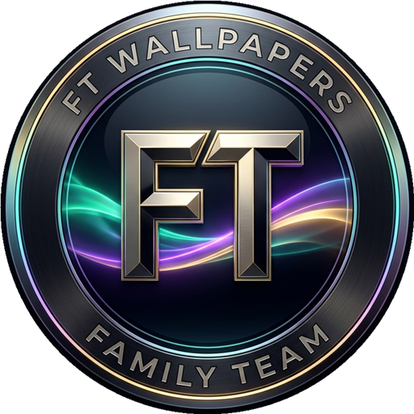

# FT Wallpaper
### استوديو الخلفيات الحية والاحترافية 4K/8K الرسمي لعائلة Family Team (Windows Desktop Edition)

**استوديو خلفيات سطح مكتب احترافي بتصميم `#181A1F`، متكامل مع محرك `Wallhaven API v1` (مع تجاوز حجب DNS تلقائياً عبر Cloudflare DoH)، ويدعم 1 و2 و3 و4+ شاشات (الأفقية والعمودية) بـ 3 أوضاع متقدمة مع إيقاف تلقائي ذكي أثناء الألعاب (`0% CPU/GPU`)!**

 

[-v1.6.3-2D7FF9?style=for-the-badge&labelColor=181A1F)](https://github.com/yousefali20062005/ft-wallpapers-app/releases/latest)

---

## ✨ أبرز مميزات الإصدار `v1.6.3`

- **🖥️ تثبيت ذكي فوري لأبعاد الشاشات الطولية والمتعددة أثناء الألعاب (`Progman Drift Guardian`):**
  - مراقبة مستمرة لموضع نافذة `Progman` ومقاسات جميع الشاشات (`SyncAllHostBounds`) ومزامنة متعددة المراحل عند تغيير دقة الشاشة (`OnDisplaySettingsChanged` عند `500ms` و`1400ms` و`2600ms`) لمنع انزلاق الخلفية أو انقسام الشاشة العمودية أثناء تشغيل الألعاب بملء الشاشة (`Fullscreen`).
- **🎯 وضع «خلفية لكل شاشة» افتراضياً + استهلاك منخفض للذاكرة وتشغيل تلقائي في السهم (`^`):**
  - تحميل كسول وتفريغ فوري لـ `WebView2` عند التصغير لشريط المهام أو البدء المصغر (`--autostart`) مع بيئة `SharedWebView` موحّدة وتنظيف دوري لـ `WorkingSet` و`.NET LOH`.
  - دعم كامل لويندوز 11 `24H2/25H2` (`DirectComposition`) مع فحص البايتات الأولى لدعم صور `GIF89a` و`WebP` و`HTML5 Web`.

- **🎨 تصميم استوديو فاملي تيم النظيف والعملي (بأسلوب FT Movies و FT Music):**
  - واجهة `#0B0D13` / `#11141D` هادئة ومرتبة بدون أي شرائط زائدة أو تكدس بالخيارات، مع بطاقات عرضية واسعة (`16:10`)، وشريط علوي موحد، وقائمة فلاتر جانبية مطوية افتراضياً، وقسم متقدم قابل للطي داخل لوحة المعاينة.
- **🌐 9 محركات بحث وخلفيات عالمية مدمجة (آلاف النتائج العربية والإنجليزية):**
  - تكامل شامل مع **`Workshop Hub` (2.5M+ خلفية)**، **`Wallhaven API v1` (4K/8K)**، **`Sakuga Live MP4/WebM`**، **`Yande.re 4K/8K`**، **`Konachan 4K`**، **`Safebooru 5M+`**، **`Danbooru 7.5M+`**، **`Wikimedia & NASA 4K Video`**، و**`16 خلفية تفاعلية 60fps`** مع اختيار مباشر للمحرك من شريط الأدوات وترجمة تلقائية فورية للبحث العربي!
- **📦 استيراد تلقائي لمكتبة الورك شوب المثبتة محلياً (`Workshop 431960` + `myprojects`):**
  - فحص واستخراج ذكي لملفات الفيديو `.mp4`/`.webm`، والخلفيات التفاعلية `HTML5`، وصور الـ 4K المضغوطة داخل `.tex` / `scene.pkg` في تبويب **`مثبّت`**.
- **🎨 واجهة استوديو احترافية ثنائية اللغة (`العربية RTL` + `English LTR`):**
  - تصميم داكن أنيق (`#181A1F` / `#202228` / `#2D7FF9`) مع تبديل فوري بين العربية والإنجليزية من الإعدادات.
  - 3 تبويبات رئيسية: **`مثبّت`**، **`استكشف`** (صفوف كاروسيل أفقية 7 بطاقات)، و**`تصفح Wallhaven`**.
- **🌐 تكامل كامل مع `Wallhaven API v1` (مع Cloudflare DoH):**
  - بحث متقدم يدعم `+tag`، `-tag`، `@username`، `like:{id}`، `type:png`.
  - شريط فلاتر جانبي قابل للطي يضم الفئات (`عام / أنمي / أشخاص`)، التصنيف العمري (`G / PG13 / R`)، الأبعاد (`4K / 2K / 1080p / Ultrawide`)، **29 لوناً سداسياً تفاعلياً**، و**24 وسماً جاهزاً**.
  - تصفح مجموعات المستخدمين ومجموعاتك الخاصة ومزامنة مفتاح `X-API-Key` من تبويب **الإضافات**.
- **🖥️ نافذة `اختيار شاشة` التفاعلية لدعم تعدد الشاشات (الأفقية والعمودية):**
  - **خلفية لكل شاشة (`Per-Monitor`)**، **تمديد خلفية واحدة (`Span All`)**، أو **استنساخ خلفية واحدة (`Clone`)**.
  - أزرار **`جمع`**، **`فصل`**، **`حفظ/تحميل الملف الشخصي`**، كتم صوت كل شاشة على حدة، وتغيير أو حذف الخلفية بضغطة زر.
- **🎛️ لوحة خصائص ومعاينة فورية (`Inspector`) + إعدادات مسبقة (`Presets`):**
  - معاينة حية لقلب الخلفية (`Flip`)، فلاتر الصور (`Grayscale / Sepia / Vivid / Invert / Blur / Sharpen`)، السطوع، التباين، التشبع، تدرج اللون (`Hue`)، والمؤثرات الحية (`مطر / ثلج / ساكورا / شرار / نجوم`) مع حفظ ومشاركة `JSON`.
- **⚙️ نافذة إعدادات متكاملة من 4 تبويبات (`الأداء`، `عام`، `الإضافات`، `حول`):**
  - تحكم بقواعد التوقف أثناء الألعاب، الجودة (`منخفضة / متوسطة / عالية / فائقة`)، معدل الإطارات (`FPS`)، التشغيل التلقائي بأولوية عالية، وشفافية أيقونات سطح مكتب ويندوز الحقيقية (`10%–100%`).

---

## 📥 طريقة التحميل والتثبيت (ويندوز 10 / 11 — 64-bit)

1. اضغط على زر **[تحميل أحدث إصدار للويندوز](https://github.com/yousefali20062005/ft-wallpapers-app/releases/latest)** وحمّل ملف **`FTWallpapers_Setup.exe`**.
2. شغّل ملف التثبيت واستمتع بأقوى استوديو خلفيات حية لعائلة **Family Team**!

---

  صُمّم خصيصاً لمجتمع وعائلة <strong>Family Team</strong> 💎

